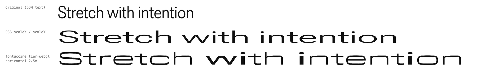

# Fontuccine

Framework-agnostic, hardware-accelerated font **stretching** that reads like
motion design — not like `scale()`. Interaction-driven (scroll velocity, cursor
proximity, hover, or your own signal), typographically correct on **any**
outline font.

`scale()` distorts everything uniformly — stems fatten, serifs smear, counters
collapse. Fontuccine widens text the way a type designer would:

1. **Real wider instances first.** For a variable font the SVG/WebGL tiers walk
   the font's own width axes (`wdth` to its maximum, then `XTRA`; the reverse to
   compress) with the in-house instancer, and blend neighbouring instances
   placed close enough that the blend stays within 1/500 em of the true
   instance. Every letter, diagonals included, keeps a shape its designer drew.
2. **Then only straight horizontal parts.** Past the widest designed instance,
   the remaining width goes only into columns whose every visible edge is
   near-horizontal (bars, the flat tops of bowls, the inside of `o`/`e`/`H`),
   plus even letter-spacing between glyphs. Columns crossed by a diagonal never
   widen, so `v w x y k A` are never sheared, bent or thickened.

A static font (or a font without a width axis) uses step 2 alone.



*Real browser capture (headless Chrome, 2× DPR) of the WebGL tier on Roboto Flex
at 2.5×: original DOM text, CSS `scaleX(2.5)`, and Fontuccine's tangent-aligned
stretch. Captured with the earlier flex-only model; not yet regenerated for the
width-plan model described above.*

- **Zero required runtime deps** — `opentype.js` is imported lazily, only when a tier actually parses an outline (never in the base bundle).
- **Three render tiers, auto-dispatched** — WebGL2, SVG, or native variable-font `wdth`, picked from device capability (override with `tier`). Every tier honours the host's CSS `color`; every fall-through is written to `instance.notes`.
- **Renders the instance you styled** — for a variable font the SVG/WebGL tiers instance the outlines at the element's computed `font-weight` / `font-stretch` / `font-style` / `font-optical-sizing` / `font-variation-settings` (own `gvar`/`avar` interpolation, verified against fontTools), so a `font-weight: 700` heading stays bold when the overlay takes over — the same design instance the browser draws.
- **Horizontal today** — `axis: 'horizontal'` is the implemented axis; `'vertical'` / `'dual'` are accepted but not rendered yet (see *Key config*).
- **Correct by construction** — 193 tests over the math core (17/17 geometric invariants), the MSDF generator against real Roboto Flex glyphs, tier parity, kerning, winding, worker transport + main-thread fallback, and SSR safety; `npm run harness` adds a real-Chrome pixel gate (WebGL ink vs exact SVG ink).
- **Any framework, or none** — a vanilla `attach()` core plus a thin React wrapper (`fontuccine/react`). Real DOM text always stays for selection / SEO / a11y.

## Install

```bash
npm install fontuccine
```

## Quickstart

```js
import { Fontuccine } from 'fontuccine';

const stretch = Fontuccine.attach('#headline', {
  fontUrl: '/fonts/RobotoFlex-VF.ttf',
  axis: 'horizontal',
  trigger: 'scroll-velocity',   // or 'mouse-proximity' | 'hover' | 'custom'
  maxStretchRatio: 2.0,
});

// trigger:'custom' — drive it yourself (clamped to [min,max]):
stretch.set(1.6);

await stretch.ready;   // renderer attached
stretch.tier;          // 'webgl' | 'svg' | 'vf' — what actually rendered
stretch.notes;         // tier-selection + fall-through trail
stretch.destroy();     // tear down + restore the DOM (leaks nothing)
```

`attach(target, config)` takes a selector or an `Element` and returns an
`Instance` (`set`, `destroy`, `tier`, `ready`, `notes`). The engine needs the
font outline binary for the SVG/WebGL tiers — pass it via `fontUrl` or
`fontBuffer`.

**Font formats:** `.ttf`, `.otf` and `.woff` (the bundled `opentype.js` parser).
**`.woff2` is not supported** — it needs a Brotli decoder the package does not
ship; passing one rejects `ready` up front with a `FontUnavailableError` that
says so. Convert to TTF/WOFF, or decompress yourself and pass `fontBuffer`.

**Variable fonts:** the SVG/WebGL tiers do not render the font file's default
instance — they instance the outlines at the axes the element resolves to
(`wght` from `font-weight`, `wdth` from `font-stretch`, `ital`/`slnt` from
`font-style`, `opsz` from the font size when `font-optical-sizing` is `auto`,
then `font-variation-settings` on top), so the overlay matches what the browser
draws for that element. Override or disable with `fontVariations`
(`{ wght: 700 }` | `false`). Limits: TrueType-flavoured variable fonts only
(`glyf` + `gvar`; a CFF2 font renders its default instance and says so in
`instance.notes`); kerning uses default-instance values (GPOS variations are
not applied); the `wdth` axis is *also* what Tier 0 animates, so under
`tier:'vf'` the CSS `font-stretch` at rest is the stretch baseline.

**Ink match with native text:** browsers draw text a fraction of a pixel
bolder than its outline (Skia's contrast boost; CoreText font smoothing on
macOS), so an outline-exact overlay reads lighter than the text it replaces —
measured on Chrome/macOS: +0.53 px per edge at DPR 1, +0.36 device px at DPR 2,
about 8 % more ink. At attach the SVG/WebGL tiers therefore run one offscreen
canvas probe (the host's own glyphs drawn as text and as their outline; canvas
text uses the same rasteriser, measured within 0.02 px) and dilate their ink by
the measured amount — a distance-threshold shift in the MSDF shader, a
same-colour round-joined stroke in SVG. Result on the playground hero: ink count
within 0.5 % of the native text, stem widths within 1 px, IoU 0.955 (WebGL) /
0.961 (SVG) against the browser's own rendering. `inkDilation: 0` renders the
exact outline; a number forces the dilation in CSS px per edge. Limits: the
probe needs a canvas-expressible instance (numeric weight, keyword
`font-stretch`, `font-variation-settings: normal`, `font-optical-sizing: auto`)
and a loadable CSS font, otherwise the tiers render the exact outline and a note
says so; SVG cannot erode, so a rasteriser thinner than the outline is matched by
the WebGL tier only; `-webkit-font-smoothing: antialiased` at DPR 1 (macOS) is
mapped to 0 by rule, since canvas ignores that property.

**Workers:** the analysis and MSDF workers are bundled *into* the package as
Blob-URL workers (no bundler worker config needed). Where `Worker` is
unavailable or blocked (strict CSP, some sandboxes) the same code runs on the
main thread and the reason lands on `instance.notes`.

### React

```jsx
import { Fontuccine, useFontuccine } from 'fontuccine/react';

// component — memoize `config` to avoid re-attaching
<Fontuccine as="h1" config={{ trigger: 'hover', fontUrl: '/fonts/MyFont.ttf' }}>
  Stretchy
</Fontuccine>

// or the hook on your own ref
const ref = useRef(null);
useFontuccine(ref, { trigger: 'mouse-proximity' });
```

`react` / `react-dom` are peer deps; the wrapper is SSR-inert and StrictMode
double-mount safe.

## Render tiers

The SVG and WebGL tiers consume the same width plan (instances + straight-column
weights), so the look is stable across the fall-through ladder:

| Tier | Backend | How it stretches |
|---|---|---|
| **1** | WebGL2 + runtime MSDF atlas (64 px/em, 8-texel range, error-corrected, overlapping-contour aware) | GPU slice-grid remap through the LUT texture; matches the SVG tier's ink to ≥ 0.96 IoU at 2.5× (harness gate); supports `effects` (grain, aberration, displacement); stretch-only; draws into a canvas *inside* the host, so it stacks like any element (under your modals) |
| **2** | SVG | béziers split at slice boundaries → per-slice affine = mathematically exact; the no-WebGL / fidelity path; supports compression |
| **0** | Native variable font | drives the font's real `wdth` axis — cheapest, when the font has one and the requested range fits its designed axis |

`tier: 'auto'` (default) probes capability and picks the best available; every
selection and fall-through reason lands on `instance.notes`. Import a tier
directly via `fontuccine/webgl`, `fontuccine/svg`, or `fontuccine/vf`.

> **Compression caveat:** under `tier:'webgl'` the effect is stretch-only — a
> requested compression (effective stretch < 1) clamps to the glyph's natural
> width. Use `tier:'svg'` when you need compression fidelity.

## Key config

| Option | Meaning |
|---|---|
| `axis` | `'horizontal'` — the only axis rendered in 0.1.x. `'vertical'` and `'dual'` type-check and are accepted for forward compatibility, but every tier renders horizontally and logs a one-time `console.warn` |
| `maxStretchRatio` / `minStretchRatio` | stretch bounds |
| `edgeProtection` | Pagurek's *k* used to find stroke direction per column (default 8) |
| `maxShareFactor` | legacy: share cap of the old flex-only model, used only if a renderer is driven without a width plan |
| `lutResolution` | slices per axis (analysis resolution) |
| `trigger` | `'scroll-velocity' \| 'mouse-proximity' \| 'hover' \| 'custom'` |
| `physics` / `easingCurve` | spring (`stiffness`/`damping`) or eased motion |
| `effects` | Tier-1 only: `grain`, `aberration`, `displacement` |
| `tier` | force a renderer; omit for auto |
| `wrap` | `'nowrap' \| 'reserve'` — reserve layout so stretching doesn't reflow neighbors |
| `fontVariations` | variable-font instance for the SVG/WebGL tiers: defaults to the element's computed font-* values; `{ wght: 700, wdth: 100 }` overrides; `false` forces the file's default instance |
| `inkDilation` | `'auto'` (default) measures the host's text-rasteriser dilation with a canvas probe and matches it; a number forces CSS px per edge; `0` renders the exact outline |
| `respectReducedMotion` | honor `prefers-reduced-motion` |

## Playground

A Vite app that exercises every tier, effect, and parameter live (and doubles as
the QA visual harness):

```bash
cd playground
npm install
npm run dev     # http://localhost:5173 — hot-reloads the engine source
```

## Develop

```bash
npm install
npm run build      # tsup → dist/ (ESM + .d.ts, per-tier entry points)
npm test           # node --test — 193 tests
npm run typecheck
npm run harness    # headless Chrome: tier matrix + WebGL↔SVG pixel gate (needs Chrome)
npm run demo       # scripts/demo.ts — core-math SVG illustration (not the renderer)
```

## How it works

`RESEARCH.md` documents the R&D behind the design — the tangent-aligned flex
profile (Pagurek 2025), verified performance facts, the pipeline benchmark, and
the risks. `refs/` holds the annotated sources and standalone reference
implementations (flex profile, LUT remap, MSDF stretch shader).

## License

[MIT](LICENSE) © Charbel Malo

## Reproducible packaged demo

The [horizontal type study](examples/portfolio/index.html) compares native text, CSS scaleX and Fontuccine. Run `npm run demo:verify -- --output /path/to/new-report` after installing root and playground dependencies. It packs this checkout, installs the tarball into an isolated consumer, builds a portable site and exercises real Chrome rendering at desktop and mobile widths. Set `CHROME_PATH` if Chrome is not in its standard macOS location. The consumer install uses the local npm cache in offline mode.

The verifier checks specimen-only pixel changes, keyboard width control, reset, no horizontal page overflow and console errors. Reduced motion selects the automatic SVG fallback, holds width at 1× and disables width controls. This demo covers one Roboto Flex TrueType fixture, horizontal WebGL2/SVG stretching and the native width-axis tier from 1–1.5×. It does not establish support for vertical/dual-axis effects, WOFF2 outlines, CFF2 variations, other fonts or other browsers. The generated site includes the font and OFL licence; serve it over HTTP.
